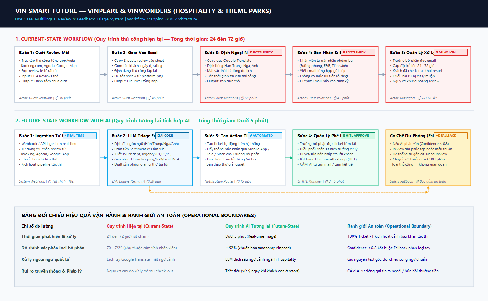
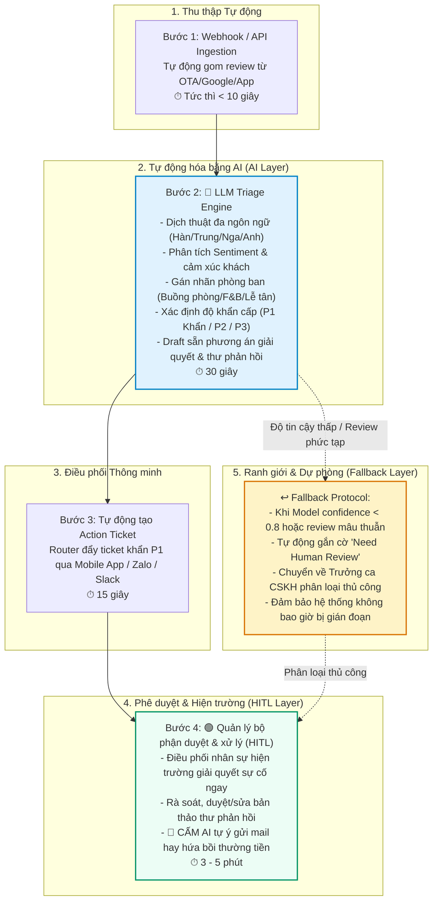

# 📊 Sơ Đồ Quy Trình Vận Hành (Workflow Mapping Diagram) — Vin Smart Future

> **Đơn vị:** Vin Smart Future (Vingroup)  
> **Mảng kinh doanh lựa chọn:** **Vinpearl & VinWonders (Hospitality & Theme Parks)**  
> **Bài toán tập trung:** **Multilingual Review & Feedback Triage System** *(Hệ thống phân tích, phân loại và điều phối phản hồi khách hàng đa ngôn ngữ theo thời gian thực)*  
> **Deliverable:** Gate G1 — Workflow Mapping (20 điểm)

---

## 🖼️ Sơ Đồ Trực Quan Hóa Quy Trình (Workflow Diagram)



---

## 📌 1. Quy Trình Hiện Tại (Current-State Workflow Mapping)

Quy trình xử lý phản hồi và đánh giá của khách du lịch quốc tế hiện tại tại Vinpearl / VinWonders:

```text
┌────────────────┐     ┌────────────────┐     ┌────────────────┐     ┌────────────────┐
│ BƯỚC 1         │     │ BƯỚC 2         │     │ BƯỚC 3         │     │ BƯỚC 4         │
│ Nhân viên CSKH │     │ Copy & dán vào │     │ Dịch review    │     │ Gán nhãn thủ   │
│ truy cập từng  │ ──> │ file Excel     │ ──> │ ngoại ngữ qua  │ ──> │ công & soạn    │
│ nền tảng đọc   │     │ tổng hợp       │     │ Google         │     │ báo cáo email  │
│ review mới     │     │                │     │ Translate      │     │ gửi các sếp    │
│                │     │                │     │                │     │                │
│ Ai: Guest Rel. │     │ Ai: Guest Rel. │     │ Ai: Guest Rel. │     │ Ai: Guest Rel. │
│ ⏱ 30 phút     │     │ ⏱ 45 phút      │     │ ⏱ 60 phút 🔴   │     │ ⏱ 45 phút 🔴   │
│ In: Web/OTA/App│     │ In: Text thô   │     │ In: Raw text   │     │ In: Bản dịch   │
│ Out: Raw list  │     │ Out: Excel row │     │ Out: Vi/En text│     │ Out: Email/Log │
└────────────────┘     └────────────────┘     └────────────────┘     └────────────────┘
                                                                               │
                                                                               ▼
                                                                        ┌────────────────┐
                                                                        │ BƯỚC 5         │
                                                                        │ Quản lý bộ     │
                                                                        │ phận đọc email │
                                                                        │ và chỉ đạo đội │
                                                                        │ hiện trường    │
                                                                        │ Ai: Managers   │
                                                                        │ ⏱ 2-3 NGÀY 🔴  │
                                                                        └────────────────┘
```

### 🔴 Phân tích Điểm nghẽn Cổ chai (Bottlenecks) & Chuyển giao (Handoffs):
1. **Bước 3 (Dịch ngoại ngữ — 60 phút 🔴):** Review từ khách quốc tế (Hàn Quốc, Trung Quốc, Nga, Anh...) chứa nhiều từ lóng du lịch, sắc thái cảm xúc. Việc copy-paste từng dòng qua Google Translate tốn nhiều thời gian và làm méo mó ngữ cảnh khiếu nại.
2. **Bước 4 (Gán nhãn & Soạn báo cáo — 45 phút 🔴):** Phân loại thủ công phụ thuộc cảm tính cá nhân của nhân viên, dễ nhầm lẫn giữa phản ánh Buồng phòng (Housekeeping) với Kỹ thuật (Engineering) hoặc Ẩm thực (F&B); không có hệ thống xếp mức độ ưu tiên P1/P2/P3.
3. **Bước 5 (Quản lý xử lý — 2–3 ngày 🔴):** Báo cáo gửi qua email định kỳ khiến các phản ánh khẩn cấp (P1: phòng bẩn, có côn trùng, ngộ độc thực phẩm, mất an toàn trò chơi) bị trôi. Đến khi quản lý đọc được thì khách đã check-out khỏi resort, dẫn đến mất khách và điểm đánh giá trên OTA sụt giảm nghiêm trọng.

* **Tổng thời gian phản hồi thực tế:** **24 – 72 giờ**.

---

## 🚀 2. Quy Trình Tương Lai Tích Hợp AI (Future-State Flow with AI)

Quy trình tương lai ứng dụng kiến trúc **LLM Feature kết hợp Rule-based Router** với cơ chế **Human-in-the-Loop (HITL)** và **Fallback**:



---

## ⚖️ 3. Bảng Đối Chiếu Hiệu Quả & Ranh Giới Vận Hành

| Tiêu chí đo lường | Quy trình Cũ (Current-State) | Quy trình Mới với AI (Future-State) | Ranh giới An toàn (Operational Boundary) |
| :--- | :--- | :--- | :--- |
| **Thời gian phát hiện & xử lý (Triage Speed)** | 24 đến 72 giờ *(rất chậm)* | **Dưới 5 phút** *(Real-time Triage)* | 100% Ticket loại P1 kích hoạt cảnh báo khẩn đến điện thoại Quản lý trong 1 phút |
| **Độ chính xác phân loại bộ phận** | 70 – 75% *(phụ thuộc cảm tính)* | **≥ 92%** *(chuẩn hóa theo taxonomy Vinpearl)* | Confidence score $< 0.8$ tự động kích hoạt luồng Fallback phân loại tay |
| **Khả năng xử lý đa ngôn ngữ** | Dịch tay Google Translate, mất sắc thái | LLM dịch sâu ngữ cảnh chuyên ngành Hospitality | Luôn lưu kèm văn bản gốc để đối chiếu song ngữ khi cần |
| **Rủi ro truyền thông & Pháp lý** | Nguy cơ cao do khách đã check-out mới giải quyết | Triệt tiêu *(xử lý sự cố ngay khi khách còn ở resort)* | **CẤM TUYỆT ĐỐI:** AI không được tự ý gửi tin nhắn/email công khai hoặc tự hứa hoàn tiền/voucher |
| **Sự can thiệp của con người (HITL)** | 100% thủ công từ nhập liệu đến báo cáo | **Human-in-the-Loop tại khâu phê duyệt cuối** | Bắt buộc Quản lý ký duyệt bản thảo trước khi gửi phản hồi ra ngoài |
